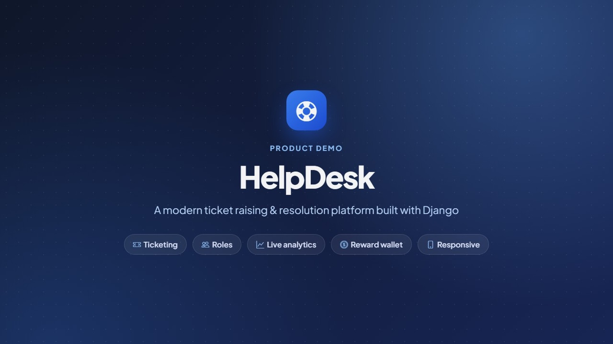

# HelpDesk

A ticket raising and resolution platform built with Django. Customers raise support tickets, support agents pick them up and resolve them, and customers confirm the fix with a rating or reopen the ticket if the problem isn't solved. A built-in coin wallet lets customers offer a reward, which is paid to the agent when the ticket is closed.

## Demo video

[](demo/helpdesk-demo.mp4)

**[Watch the 4-minute walkthrough](demo/helpdesk-demo.mp4)** (1080p MP4). It follows one ticket from start to finish:
a customer raises it, an agent takes, answers and resolves it, and the customer rates it and closes it, which pays the coin reward.
Then it tours the dashboards, the Team page, the Activity log, dark mode and the mobile layout.

---

## Contents

1. [Quick start](#quick-start)
2. [Demo accounts and data](#demo-accounts-and-data)
3. [Roles and permissions](#roles-and-permissions)
4. [Ticket workflow](#ticket-workflow)
5. [Features](#features)
6. [Pages and URLs](#pages-and-urls)
7. [Testing every feature step by step](#testing-every-feature-step-by-step)
8. [Configuration](#configuration)
9. [Project structure](#project-structure)
10. [Running the tests](#running-the-tests)
11. [Troubleshooting](#troubleshooting)

---

## Quick start

Requirements: Python 3.10 or later (developed on 3.12).

```bash
pip install -r requirements.txt
python manage.py migrate
python manage.py seed_demo        # load demo users, categories and tickets
python manage.py runserver
```

Open **http://127.0.0.1:8000/** and log in with one of the demo accounts below. While `DEBUG` is on, the login page also lists the demo accounts.

To create your own administrator instead, run:

```bash
python manage.py createsuperuser
```

A superuser automatically gets the **Admin** role in the app.

---

## Demo accounts and data

`python manage.py seed_demo` creates the following:

| Role     | Username | Password    | Name / department                 |
|----------|----------|-------------|-----------------------------------|
| Admin    | `admin`  | `Admin@123` | Site Admin, IT Management         |
| Agent    | `priya`  | `Demo@1234` | Priya Sharma, IT Support          |
| Agent    | `rahul`  | `Demo@1234` | Rahul Verma, Network Operations   |
| Customer | `anita`  | `Demo@1234` | Anita Desai, Finance              |
| Customer | `vikram` | `Demo@1234` | Vikram Singh, Sales               |
| Customer | `neha`   | `Demo@1234` | Neha Gupta, Human Resources       |

It also creates:

- **6 categories:** Hardware, Software, Network, Account & Access, Email, and Billing & Payroll.
- **Wallets:** a 500-coin welcome bonus for `anita`, `vikram`, `neha` and `priya`. After the seeded rewards are paid out, the balances are anita 490, vikram 485, neha 500, priya 525 and rahul 0.
- **15 tickets** covering every status:

| #  | Title | Requester | Status | Assignee | Shows |
|----|-------|-----------|--------|----------|-------|
| 1  | Laptop won't power on after Windows update | anita  | Open        | —     | Urgent, **overdue**, 50-coin reward |
| 2  | Cannot access shared drive S:              | vikram | Open        | —     | Customer reply, 30-coin reward |
| 3  | New employee account for Kiran Rao         | neha   | In Progress | rahul | Assigned by admin |
| 4  | Outlook keeps asking for my password       | anita  | In Progress | priya | Back-and-forth conversation and an **internal note** |
| 5  | VPN disconnects every 10 minutes           | vikram | On Hold     | rahul | Hold reason, **overdue** |
| 6  | Printer on 3rd floor printing blank pages  | neha   | Resolved    | priya | Waiting for the customer to close or reopen |
| 7  | Excel crashes when opening large files     | anita  | Reopened    | rahul | Reopen reason shown in the conversation |
| 8  | Install Adobe Acrobat Pro                  | vikram | Closed      | priya | 5★ rating, 15 coins paid |
| 9  | Payroll portal shows wrong leave balance   | neha   | Closed      | rahul | 4★ rating |
| 10 | Forgot ERP password                        | anita  | Closed      | priya | 5★ rating, 10 coins paid |
| 11 | Mouse is double-clicking                   | vikram | Open        | —     | Just raised, no due date |
| 12 | Wi-Fi very slow in conference room B       | neha   | In Progress | priya | **Overdue**, internal note |
| 13 | Request a second monitor                   | anita  | Closed      | rahul | 3★ rating with feedback |
| 14 | Need admin rights to install a diagnostic tool | priya | In Progress | rahul | An agent raising a ticket |
| 15 | Email signature not showing company logo   | vikram | Open        | —     | 5-coin reward |

Ticket timestamps are spread over the past two weeks, so the dashboard and history look realistic. Due dates are relative to the day you run the command.

| Command | What it does |
|---------|--------------|
| `python manage.py seed_demo` | Creates or updates the demo users and categories. Adds the tickets only if no tickets exist yet. |
| `python manage.py seed_demo --reset` | Deletes **all** tickets and transactions, resets every wallet to 0, and recreates the demo set. |

Running the command again always resets the demo users' passwords to the values above.

---

## Roles and permissions

Every user has a profile with one of three roles. New sign-ups are **Customers**. An admin can change roles under **Admin → Manage users**.

| Action | Customer | Agent | Admin |
|--------|:--------:|:-----:|:-----:|
| Raise a ticket | ✅ | ✅ | ✅ |
| See tickets | Own only | All | All |
| Reply on a ticket | Own (unless closed) | ✅ (unless closed) | ✅ (unless closed) |
| Add an **internal note** (hidden from customers) | ❌ | ✅ | ✅ |
| Edit a ticket | Own, while Open **and** unassigned | Own, while Open and unassigned | Any ticket that isn't closed |
| Delete a ticket | Own, while Open **and** unassigned | Own, while Open and unassigned | Any ticket |
| Take an unassigned ticket | ❌ | ✅ (not their own) | ✅ (not their own) |
| Assign or reassign to an agent | ❌ | ✅ | ✅ |
| Put on hold, resume, resolve, release | ❌ | Only tickets assigned to them | Any assigned ticket |
| Close (with rating) or reopen a resolved ticket | Own | Own | Any |
| Set a coin reward | Own tickets | Own tickets | Own tickets |
| Add coins to any wallet | ❌ | ❌ | ✅ |
| Change user roles | ❌ | ❌ | ✅ (cannot remove their own admin role) |
| Django admin (`/admin/`) | ❌ | ❌ | Superusers only |

Access rules are enforced on the server, not only hidden in the page:

- Opening another customer's ticket returns **404**, so nobody can find out which ticket numbers exist.
- Admin-only pages return **403** to everyone else.
- Every action that changes a ticket must be submitted from a form with a security (CSRF) token. Visiting an action URL directly does nothing (it returns **405**).

All of these rules live in one place: [`myapp/permissions.py`](myapp/permissions.py).

---

## Ticket workflow

```
           take / assign
   Open ─────────────────►  In Progress  ◄──── resume ────┐
    ▲                         │      │                    │
    │         release         │      └────── hold ──► On Hold
    └─────────────────────────┤
                              │ resolve (resolution summary required)
                              ▼
                           Resolved ───── close (optional 1–5★ rating + feedback) ────► Closed
                              │                 (reward paid to the agent here)
                              │ reopen (reason required)
                              ▼
                           Reopened ── resolve / hold / release, or take / assign if it was released
```

| Status | Meaning |
|--------|---------|
| **Open** | Newly raised, or released back to the queue, and waiting for an agent. |
| **In Progress** | An agent is working on it. |
| **On Hold** | Paused, for example while waiting on a supplier or the customer. An optional reason is recorded. |
| **Resolved** | The agent has fixed it and written a resolution summary. Waiting for the customer to confirm. |
| **Reopened** | The customer says the problem isn't fixed. It stays with the same agent. |
| **Closed** | The customer confirmed the fix. This is final: no more edits or replies. |

Rules:

- A ticket can't be assigned to the person who raised it, or to a user who isn't an agent or admin.
- Resolving requires a resolution summary. Reopening requires a reason, which is posted to the conversation.
- **Closing pays the reward.** If the requester's wallet no longer has enough coins, the close is refused and nothing changes. The admin can top up the wallet and the customer can then try again.
- Every action is written to the ticket's **History** with who did it and when.

The workflow code is in [`myapp/services.py`](myapp/services.py).

---

## Features

### User interface
- **App layout:** a sidebar with live counters (My queue, Unassigned, Overdue, Raised by me, Awaiting my review), your wallet balance, and a sticky top bar. On phones and tablets the sidebar becomes a slide-out menu.
- **Global search** in the top bar. Press <kbd>/</kbd> from any page to jump to it.
- **Light and dark mode:** the moon/sun button switches themes. Your choice is remembered, and the first visit follows your system setting.
- **Consistent visual language:** coloured status and priority chips, user avatars with initials, overdue and reward badges, and empty-state messages.
- **Notifications:** pop-up messages close themselves after a few seconds. Error messages stay until you dismiss them.
- **Login page:** a split-screen design. In development, clicking a demo account fills in the login form.
- **Typography:** *Plus Jakarta Sans* for all text and *JetBrains Mono* for ticket numbers. One fluid type scale is used everywhere: 15px body text, with headings that grow smoothly from phone to desktop and a slightly larger base size on monitors 1600px and wider.
- **Responsive:** checked at 375px (phone), 768px (tablet), 1280px (laptop) and 1600px (large monitor) with no horizontal scrolling.
  - The sidebar becomes a slide-out menu below 992px.
  - Ticket tables turn into cards on phones.
  - Filter bars become a two-column grid on phones.
  - On the ticket page, phones show Actions, then the conversation, then Details and History. Desktop puts the conversation on the left.
  - Animations are switched off for users who prefer reduced motion.

### Dashboard (`/`)
- **Everyone:**
  - Headline cards that link to the matching ticket list.
  - A **ticket trend chart** of tickets raised vs. resolved, with totals. It shows the **last 7 days** by default. A dropdown switches to **Today** (hourly), **Last 2 days** (every 3 hours), **Last 30 days**, or a **Custom range** of up to a year (daily, or weekly for ranges over 62 days). Your choice is remembered, and the chart updates without reloading the page.
  - A **doughnut chart** of tickets by status.
  - A banner listing any tickets that are resolved and waiting for *your* confirmation.
- **Customers** also see: resolved/closed count, wallet balance and their recent tickets.
- **Agents and admins** also see:
  - Unassigned and in-my-queue counts.
  - **My queue**, sorted by due date.
  - The latest tickets.
  - **Active by priority**: the active-ticket total, a colour bar showing the share of each priority, and one row per priority (urgent first) with its count, percentage and overdue count. Each row links to the matching tickets.
  - **Customer satisfaction**: the average rating with stars and the number of ratings.
  - **Team workload**: the 4 busiest agents, each with active and resolved counts and a load bar. Click an agent to see their tickets, or **View all** to open the Team page.
  - A **recent-activity** feed with an icon for each event type, linking to the full Activity log.

### Ticket list (`/tickets/`)
- **Search** by ticket number (`HD-00004`, or just `4`), title or description.
- **Status tabs** (All, Active, Open, In Progress, On Hold, Resolved, Closed, Reopened), each showing how many tickets match your other filters.
- **Filters:**
  - Scope: All, Raised by me, Assigned to me, Unassigned or Overdue. Customers get Raised by me and Overdue.
  - Priority and category.
- **Sort by:** newest, oldest, recently updated, highest priority, or due date.
- Each row shows the title, number, category, reward, status and priority chips, requester and assignee avatars, and the due date. Overdue dates are marked in red, and urgent and high-priority rows get a coloured left edge. Click anywhere on a row to open the ticket.
- 15 tickets per page with numbered pages. Filters are kept while you change pages.

### Raising and editing tickets
- Fields:
  - Title, category and description (required)
  - Priority: Low, Medium, High or Urgent
  - Due date (cannot be in the past)
  - Optional coin reward (cannot be more than your wallet balance)
  - Optional attachment
- Every ticket gets a readable number: `HD-00001`, `HD-00002`, and so on.
- Edits are recorded in the history along with the names of the changed fields.
- Deleting asks for confirmation first.

### Ticket detail page
- A **progress bar**: Raised → In progress (shown as *On hold* or *Reopened* when relevant) → Resolved → Closed.
- A **chat-style conversation**:
  - The original request comes first, then the replies, then the resolution and the closing rating.
  - Every message shows the author's avatar and a *Requester*, *Assignee* or *Support* label.
  - Staff replies are tinted.
  - **Internal notes** have a yellow dashed border and are never shown to customers.
- **Reply box** with a paperclip button for attachments, plus an "Internal note" checkbox for staff.
- **Actions** panel showing only the buttons you're allowed to use. Customers closing a ticket get a **star-rating picker** and a feedback box.
- **Details** panel: requester and assignee with avatars, status, priority, category, due date (e.g. "tomorrow"), reward, and the created, resolved and closed times.
- **History** timeline of every change.
- When a ticket is resolved, the customer sees a banner asking them to close it or reopen it.

### Team (`/team/`, agents and admins)
- **Summary cards:** agents, assigned and active tickets, unassigned, overdue, resolved, and the average resolution time.
- **One row per agent:**
  - Role and department, and when they were last active.
  - **Workload now:** active tickets with a load bar, plus on-hold, overdue and urgent counts.
  - Tickets **resolved** and the **average resolution time** (from raised to resolved).
  - **Customer rating** and the number of ratings.
  - **Coins earned.**
- **Period selector:** last 7, 30 or 90 days, or all time. Workload always shows the current state; the other figures cover the selected period.
- **Search** by name, email or department. **Sort** by workload, most resolved, best rated or name.
- Clicking an agent opens their active tickets (`/tickets/?assignee=<id>`).

### Activity log (`/activity/`)
- A full history of every ticket change, newest first, grouped by day (Today, Yesterday, …).
- Each entry shows who did it, what happened, the ticket, the time, and a coloured event type: created, assigned, reply, internal note, on hold, resumed, resolved, reopened, closed, released or edited.
- Summary cards: events today, events in the last 7 days, and tickets resolved and closed this week.
- **Filters:** search (ticket number, title or event text), event type, user (staff only), and a from/to date range.
- **Export CSV** (staff only) downloads the filtered log.
- Staff see every ticket's history. Customers see only their own tickets, and never staff-only internal notes.

### Attachments
- Allowed file types: `png jpg jpeg gif pdf txt log csv doc docx xls xlsx zip`.
- Maximum size is **5 MB**. You can change this with `MAX_UPLOAD_SIZE_MB` in `settings.py`.
- Files are stored in `media/` and served by Django while `DEBUG` is on.

### Coin wallet and rewards
- Every user gets a wallet automatically.
- Customers can attach a coin reward to a ticket. When they close it, the coins move to the assigned agent.
- The **Wallet** page (`/wallet/`) shows your balance and a paginated history of top-ups, rewards paid and rewards received, with links to the related tickets.
- Admins add coins under **Admin → Add coins**, or with the **Top up** button next to any user on the Manage users page.
- Wallet payments are all-or-nothing, so they can never leave a wallet below zero or charge a reward twice.

### Email notifications
The relevant people are emailed when:

| Event | Who is emailed |
|-------|----------------|
| A ticket is assigned to an agent | The agent |
| An agent takes a ticket, or one is assigned | The requester |
| A ticket is put on hold | The requester |
| A ticket is resolved | The requester (with the resolution and a request to confirm) |
| A ticket is reopened | The assigned agent |
| A ticket is closed | The agent (including any coins earned) |
| A new reply is posted (not internal notes) | The requester and the assignee, except whoever wrote the reply |

Unless SMTP is configured (see [Configuration](#configuration)), emails are **printed in the terminal** running `runserver`. Email failures never break an action.

### Accounts
- **Register** with first and last name, username, email (must be unique), password, and optional phone, department, address, city and state. You're logged in straight away.
- **Log in and log out.** Logging out is a secure form submission, not a plain link.
- **Profile page:** your details, role, wallet balance and statistics (tickets raised, active and closed). Agents also see tickets in their queue, tickets they've resolved, and their average rating.
- **Edit profile:** name, email, phone, department and address.
- **Change password**, and **forgot password**: the reset email is printed to the console in development.
- Sessions expire after **2 hours** of inactivity.

### Administration
- **Manage users** (`/users/`): every user with their role, ticket counts and wallet balance. You can change a role or top up a wallet from here.
- **Django admin** (`/admin/`): full access to tickets (with comments and history shown inline), categories, profiles, wallets and transactions. Add or rename **categories** here.

---

## Pages and URLs

| URL | Page | Who |
|-----|------|-----|
| `/` | Dashboard | Logged in |
| `/tickets/` | Ticket list with search and filters | Logged in |
| `/tickets/new/` | Raise a ticket | Logged in |
| `/tickets/<id>/` | Ticket detail, conversation and actions | Requester and staff |
| `/tickets/<id>/edit/` | Edit a ticket | See permissions |
| `/tickets/<id>/delete/` | Delete a ticket (with confirmation) | See permissions |
| `/tickets/<id>/comment/` | Post a reply or internal note (form submission only) | Requester and staff |
| `/tickets/<id>/<action>/` | `take`, `assign`, `release`, `hold`, `resume`, `resolve`, `reopen`, `close` (form submission only) | See permissions |
| `/profile/`, `/profile/edit/` | View and edit your profile | Logged in |
| `/team/` | Team workload and performance | Agents and admins |
| `/activity/` | Activity log (filters, CSV export for staff) | Logged in (customers see only their own tickets) |
| `/dashboard/trend/?range=…` | Chart data as JSON (`today`, `2d`, `7d`, `30d`, or `custom&from=YYYY-MM-DD&to=YYYY-MM-DD`) | Logged in |
| `/wallet/` | Wallet balance and transactions | Logged in |
| `/wallet/topup/` | Add coins to a wallet | Admin |
| `/users/` | Manage users and roles | Admin |
| `/register/`, `/login/`, `/logout/` | Authentication | — |
| `/password-change/` | Change password | Logged in |
| `/password-reset/` | Forgot password | — |
| `/admin/` | Django admin | Superuser |

---

## Testing every feature step by step

Run `python manage.py seed_demo --reset` first. Then try these scenarios, using a private or incognito window to switch users quickly.

**1. Customer raises a ticket and gets it fixed (with a reward)**
1. Log in as `anita`. Click **Raise Ticket** and fill in the form with a reward of 20 and an attachment.
2. Log in as `priya`, open **Unassigned**, find the new ticket, and click **Take this ticket**. Post a reply and an internal note.
3. As `anita`, open the ticket. The reply is visible, but the internal note isn't.
4. As `priya`, click **Resolve…** and enter a summary.
5. As `anita`, close the ticket with a 5★ rating. Check **Wallet**: 20 coins have gone. As `priya`, check **Wallet**: 20 coins have arrived.

**2. Reopen**
- As `neha`, open ticket **#6** (Resolved) and click **Not fixed — reopen…**. As `priya`, the ticket shows as *Reopened*, and you can resolve it again.

**3. On hold and resume**
- As `rahul`, open **#5** (On Hold) and click **Resume work**. Then put **#3** on hold with a reason.

**4. Assign and release**
- As `admin`, open **#1** and assign it to `rahul`. As `rahul`, it now appears in **My Queue**. Click **Release back to queue** and it returns to *Open* and *Unassigned*.

**5. Access rules**
- As `vikram`, open `/tickets/1/` (anita's ticket): you get *Page not found*.
- As `priya`, open `/users/`: you get *Access denied*.
- As `anita`, try to edit **#4**: it's already assigned, so editing is blocked.

**6. Not enough coins**
- As `vikram` (485 coins), raise a ticket with a reward of 9999: the form rejects it.

**7. Admin tools**
- As `admin`, open **Admin → Manage users**, change `neha` to *Support Agent*, and top up `rahul` with 100 coins. Then open `/admin/` to manage categories.

**8. Search, filters and overdue**
- On the ticket list, search `HD-00007` or `printer`. Then filter by **Overdue**, which shows #1, #5 and #12, or by priority **Urgent**.

**9. Password reset**
- Log out, click **Forgot password?**, and enter `anita@example.com`. Copy the reset link from the `runserver` terminal into your browser.

---

## Configuration

Settings are read from environment variables. The defaults are suitable for local development.

| Variable | Default | Purpose |
|----------|---------|---------|
| `DJANGO_SECRET_KEY` | Insecure development key | **Required in production.** |
| `DJANGO_DEBUG` | `True` | Set to `False` in production. This also hides the demo-account list on the login page. |
| `DJANGO_ALLOWED_HOSTS` | `localhost,127.0.0.1` | Comma-separated list of hosts. |
| `DJANGO_TIME_ZONE` | `UTC` | For example, `Asia/Kolkata`. |
| `EMAIL_HOST_USER` / `EMAIL_HOST_PASSWORD` | empty | Set **both** to send real email over SMTP. Without them, emails print to the console. |
| `EMAIL_HOST` / `EMAIL_PORT` | `smtp.gmail.com` / `587` | SMTP server (TLS). |
| `DEFAULT_FROM_EMAIL` | `EMAIL_HOST_USER` or `helpdesk@localhost` | The sender address on notifications. |

Example in PowerShell:

```powershell
$env:EMAIL_HOST_USER = "you@gmail.com"
$env:EMAIL_HOST_PASSWORD = "your-gmail-app-password"
python manage.py runserver
```

> Never put real passwords or keys in `settings.py`. Keep them in environment variables.

---

## Project structure

```
helpdesk/                  Project settings and root URLs
myapp/
  models.py                UserProfile (role), Category, Ticket, TicketComment,
                           TicketActivity, Account (wallet), Transaction
  reports.py               Dashboard chart data (time ranges and buckets)
  activity.py              Event types for the activity log
  permissions.py           Who can view, edit, delete and comment on tickets, and which actions they can use
  services.py              Ticket workflow (take, assign, hold, resolve, close, ...),
                           reward payments, top-ups and email notifications
  views.py                 Page views
  forms.py                 Forms (Bootstrap-styled) and validation
  signals.py               Creates a profile and wallet for every new user
  context_processors.py    Role flags available to every template
  admin.py                 Django admin setup
  templatetags/helpdesk.py Template helpers: avatar, status_chip, priority_chip, stars, display_name
  static/myapp/
    app.css                Design system: light/dark themes, layout, chips, cards, conversation, etc.
    app.js                 Theme toggle, notifications, clickable rows, "/" search shortcut, dashboard charts
  management/commands/
    seed_demo.py           Demo data loader
  templates/
    base.html              App layout (sidebar + top bar)
    auth_base.html         Split-screen layout for login, register and password reset
    dashboard.html, 403.html, 404.html
    partials/              Sidebar, top bar, messages, form fields, ticket table, chips, pagination
    tickets/               List, detail, form, delete confirmation
    accounts/              Login, register, profile, profile edit, user management
    wallet/                Wallet and top-up
    password/              Password change and reset pages
  tests.py                 Automated tests
```

Tech stack: Django 5.1, SQLite, Bootstrap 5.3, Bootstrap Icons, Chart.js 4 and the Inter font (all loaded from CDNs, so the pages need internet access to look right).

---

## Running the tests

```bash
python manage.py test myapp
```

The 40 tests cover:

- **Workflow:** the full ticket lifecycle with reward payment, reopening, refusing to close when the wallet is short, release, and the resolution-text requirement.
- **Permissions:** customers can't see or edit other people's tickets, internal notes stay hidden, admin pages are restricted, and actions must be submitted from a form.
- **Forms:** registration, ticket creation, the reward limit and filters.
- **Team page:** statistics, access rules, search and sort, the 4-agent dashboard limit, and the assignee filter.
- **Dashboard and activity log:** every chart range, custom-range validation, activity visibility rules, filters and CSV export.
- **Seed data:** a check that loads the demo data and opens every page as an admin, an agent and a customer.

---

## Troubleshooting

| Problem | Fix |
|---------|-----|
| `no such table` errors | Run `python manage.py migrate`. |
| Login fails with a demo account | Run `python manage.py seed_demo`. It resets the demo passwords. |
| `seed_demo` says tickets already exist | Use `python manage.py seed_demo --reset`. |
| The password-reset email never arrives | In development it's printed to the `runserver` terminal. Set `EMAIL_HOST_USER` and `EMAIL_HOST_PASSWORD` to send real email. |
| A customer can't close a ticket | Their wallet has fewer coins than the reward. An admin can top it up under **Admin → Add coins**. |
| Attachment rejected | Check the allowed file types and the 5 MB limit. |
